
<picture><source media="(prefers-color-scheme: dark)" srcset="assets/header-dark.svg">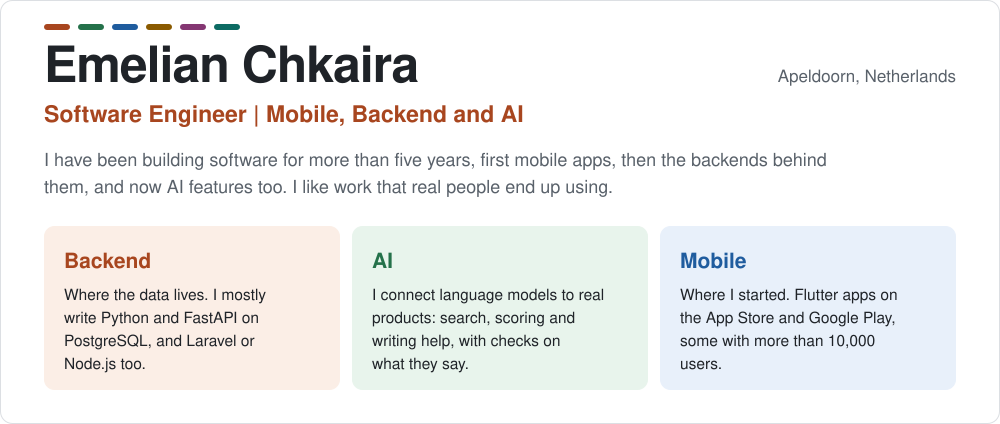</picture>

   

## What I work with

<picture><source media="(prefers-color-scheme: dark)" srcset="assets/skills-dark.svg">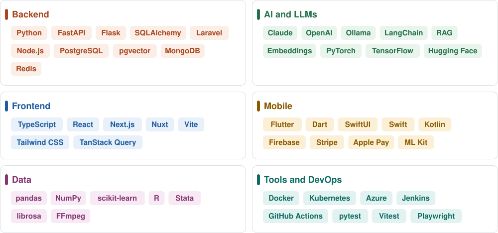</picture>

## Where I have worked

<picture><source media="(prefers-color-scheme: dark)" srcset="assets/experience-dark.svg">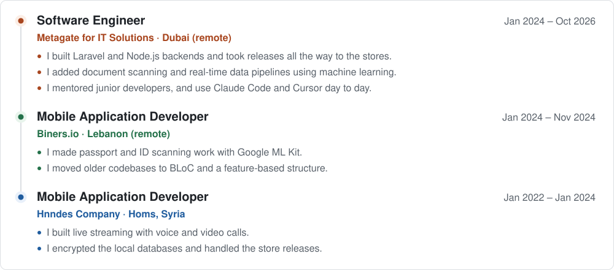</picture>

## Things I have built

<a href="https://github.com/emelian-chkaira/ai-career-tracker"><picture><source media="(prefers-color-scheme: dark)" srcset="assets/project-career-dark.svg">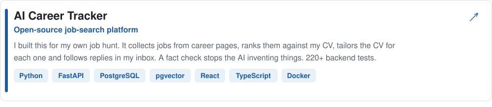</picture></a>

<a href="https://github.com/emelian-chkaira/albert-heijn-analytics-study"><picture><source media="(prefers-color-scheme: dark)" srcset="assets/project-retail-dark.svg">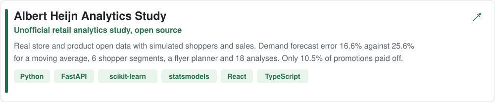</picture></a>

<a href="https://github.com/emelian-chkaira/The-Data-Mystery-GDPR-by-Gamification"><picture><source media="(prefers-color-scheme: dark)" srcset="assets/project-gdpr-dark.svg">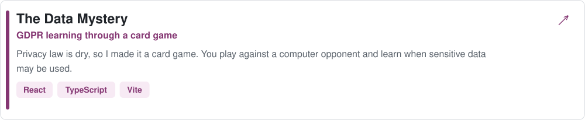</picture></a>

[AI Career Tracker live demo](https://ai-career-tracker-gmwn.onrender.com) (Render and Neon Postgres, CI with GitHub Actions) · [Mobile app](https://github.com/emelian-chkaira/ai-career-tracker-mobile) · [Retail study live demo](https://albert-heijn-analytics-study.onrender.com) · [Infographic](https://emelian-chkaira.github.io/albert-heijn-analytics-study/) · [Play The Data Mystery](https://candid-valkyrie-10dcc5.netlify.app)

## Apps and sites I shipped

<a href="https://metagate.ae/portfolio/s-hub"><picture><source media="(prefers-color-scheme: dark)" srcset="assets/app-s-hub-dark.svg">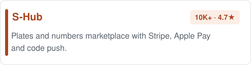</picture></a>
<a href="https://metagate.ae/portfolio/yemnzil"><picture><source media="(prefers-color-scheme: dark)" srcset="assets/app-yemnzil-dark.svg">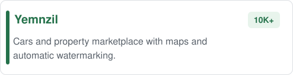</picture></a>
<a href="https://tarouq.com"><picture><source media="(prefers-color-scheme: dark)" srcset="assets/app-tarouq-dark.svg">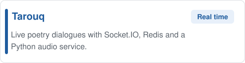</picture></a>
<a href="https://metagate.ae/portfolio/car-station"><picture><source media="(prefers-color-scheme: dark)" srcset="assets/app-car-station-dark.svg">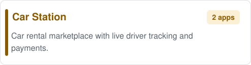</picture></a>
<a href="https://metagate.ae/portfolio/driveestate"><picture><source media="(prefers-color-scheme: dark)" srcset="assets/app-driveestate-dark.svg">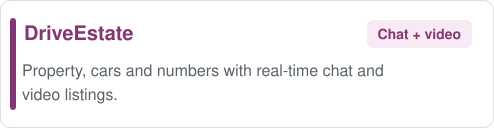</picture></a>
<a href="https://metagate.ae/portfolio/mumayaz"><picture><source media="(prefers-color-scheme: dark)" srcset="assets/app-mumayaz-dark.svg">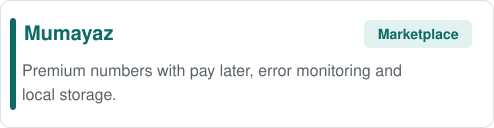</picture></a>
<a href="https://play.google.com/store/apps/details?id=com.hr_portals.hr_portal"><picture><source media="(prefers-color-scheme: dark)" srcset="assets/app-hr-dark.svg">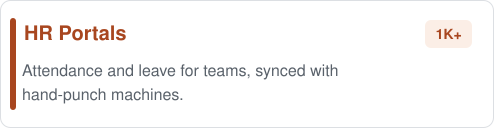</picture></a>
<a href="https://sanctuarys.nl"><picture><source media="(prefers-color-scheme: dark)" srcset="assets/app-sanctuary-dark.svg"></picture></a>

## Study, a hackathon and languages

<picture><source media="(prefers-color-scheme: dark)" srcset="assets/education-dark.svg">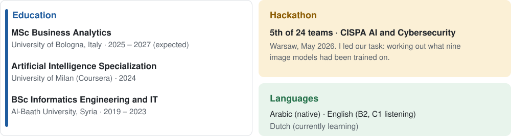</picture>

I am looking for a software engineering role or internship in the Netherlands. Say hello · <a href="https://lnkd.in/p/egmXnF-f">my hackathon post</a>

